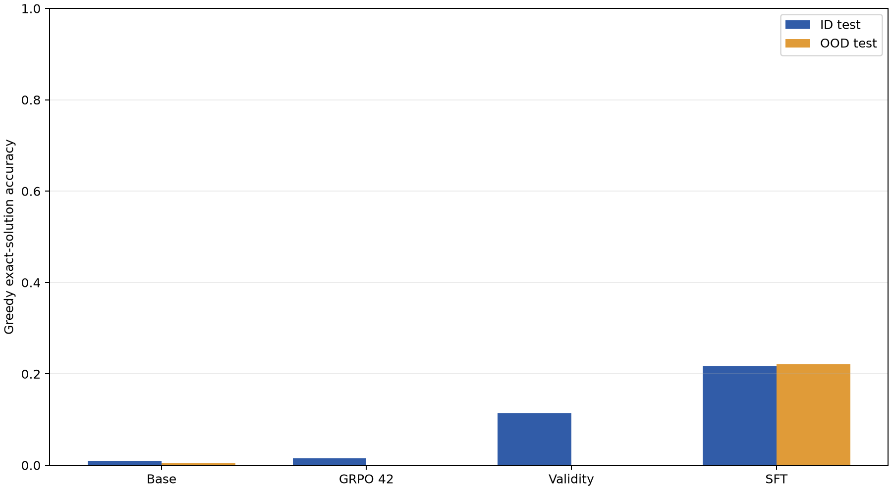
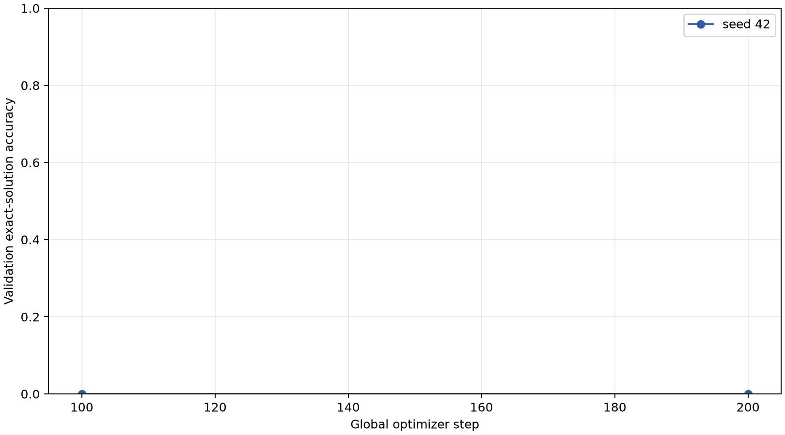

# Measured results

Generated at 2026-10-14T13:27:51+00:00. The frozen test set is only used after checkpoint selection.
Full evaluation status: **complete**.

## Greedy exact-solution accuracy

| Experiment | ID accuracy | ID valid | ID n | OOD accuracy | OOD valid | OOD n | ID pass@4 | OOD pass@4 |
|---|---:|---:|---:|---:|---:|---:|---:|---:|
| base_qwen25_15b | 1.0% | 18.4% | 1024/1024 | 0.4% | 13.7% | 512/512 | 2.7% | 2.3% |
| grpo_correct_seed_42 | 1.6% | 65.7% | 1024/1024 | 0.0% | 62.1% | 512/512 | 1.6% | 0.0% |
| grpo_correct_seed_43 | pending | pending | 0/— | pending | pending | 0/— | pending | pending |
| grpo_correct_seed_44 | pending | pending | 0/— | pending | pending | 0/— | pending | pending |
| grpo_validity_seed_42 | 11.4% | 100.0% | 1024/1024 | 0.0% | 100.0% | 512/512 | 12.1% | 0.0% |
| sft_witness_seed_42 | 21.7% | 97.6% | 1024/1024 | 22.1% | 100.0% | 512/512 | 32.0% | 40.6% |

## Paired uncertainty

A three-seed estimate was not produced: the pre-registered validation gate stopped the primary experiment before seeds 43 and 44.

Per-seed paired changes:

- Seed 42: +0.59 pp (95% CI -0.39, +1.56; n=1024).
- Seed 43: pending.
- Seed 44: pending.

Secondary paired comparisons (descriptive; one training seed each):
- `grpo_validity_seed_42` vs base: +10.45 pp (95% paired bootstrap interval +8.40 to +12.50; n=1024).
- `sft_witness_seed_42` vs base: +20.70 pp (95% paired bootstrap interval +18.07 to +23.34; n=1024).
These intervals resample test problems; they do not estimate training-seed variability.

The pre-registered step-200 validation gate did not pass, so seeds 43 and 44 were not run. Seed 42 changed validation accuracy by -0.78 percentage points against the 3.0-point threshold. The result is a budget-stopped single-seed experiment, not a three-seed estimate.

## Run evidence

Accumulated GPU time: 15.21 / 72 hours.
- `grpo_correct_seed_42`: budget_stopped, seed 42, 1200 planned steps, selected step 200; manifest `results/run_evidence/grpo_correct_seed_42/run_manifest.json`.
- `grpo_validity_seed_42`: completed, seed 42, 1200 planned steps, selected step 100; manifest `results/run_evidence/grpo_validity_seed_42/run_manifest.json`.
- `sft_witness_seed_42`: completed, seed 42, 1200 planned steps, selected step 800; manifest `results/run_evidence/sft_witness_seed_42/run_manifest.json`.

## Interpretation limits

A successful result supports only the stated Countdown task and prompt. It does not show a general increase in reasoning ability. OOD tests change the integer range only. SFT has privileged witness labels; GRPO does not. Report negative or partial outcomes as measured.

## Figures

